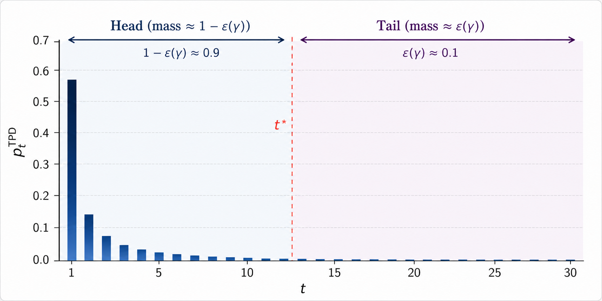

<p align="center">
  
</p>

# Stabilised weighted data subsampling

This repository contains code to reproduce the results in:

Quiroz, M., Bhaskaran, A., Wang, Z., and Goodwin, T. (2026).  
*Stabilised weighted data subsampling for accelerated inference in models with recursive likelihoods.*  
[arXiv:2605.13397](https://arxiv.org/abs/2605.13397)

## Main reproduction notebook

`stabilised_weighted_data_subsampling_v3.ipynb` is the current notebook for the
final paper. It contains the original GARCH experiments and comparisons, followed
by the regression-GARCH dimensional stress test and its DC-BATS comparison.

`stabilised_weighted_data_subsampling.ipynb` is retained as the original
low-dimensional reproduction notebook. `sg_mcmc_runs.ipynb` generates the
SG-MCMC comparison.

The notebooks should be run cell by cell in order. Several experiments are
computationally intensive, and the production code writes restart-safe
checkpoints so interrupted calculations can be resumed.

## Regression-GARCH experiment

The regression-GARCH experiment uses five datasets for each of two cases:

- `p=25` regressors, total parameter dimension `d=29`;
- `p=50` regressors, total parameter dimension `d=54`.

Dataset 001 is used for the detailed posterior comparison. Datasets 002--005 are
computational replicates used to estimate the median speed-up of the subsampling
MCMC relative to full-data MCMC. They are not a repeated-sampling coverage study.

The model and production settings are recorded in
`regression_garch_experiment_config.json`. The production implementation is in
`regression_garch.py`, `validate_regression_garch.py`, and
`run_regression_garch_stress_test.py`. Section 7 of the Version-3 notebook calls
these functions directly.

The two dataset-001 archives are generated deterministically from the final
configuration. Their seeds and reference SHA-256 hashes are:

| Regressors | Seed | SHA-256 |
|---:|---:|---|
| 25 | 20260921 | `07a016de0093074e65d29f3a2a87fb5e9f4af0f38fe0f50ce10fa3e9fad295cd` |
| 50 | 20260922 | `fa821d80909ca019ad41fdb3938f240df1b8e91e965bac1a05525c4186180b65` |

From a fresh clone, generate them from the repository root with:

```bash
python generate_regression_garch_canonical_datasets.py --p 25
python generate_regression_garch_canonical_datasets.py --p 50
```

The script reads the seeds and design from
`regression_garch_experiment_config.json`, uses the shared simulator in
`regression_garch.py`, validates each archive, and prints its SHA-256 hash. It
generates only missing files by default and will not replace an existing file
unless `--overwrite` is supplied. The reference hashes above were obtained in
the final environment; the script reports, but does not by default reject, a
bytewise difference after the numerical and metadata checks have passed.

Datasets 002--005 are generated automatically by the Version-3 notebook from
the fixed seeds in the same configuration file.

## DC-BATS comparisons

The original GARCH(1,1) DC-BATS comparison uses `run_dc_bats_runs.R` and
`garch11_normal.stan`. Run each setting separately:

```bash
Rscript run_dc_bats_runs.R --K=10
Rscript run_dc_bats_runs.R --K=20
Rscript run_dc_bats_runs.R --K=76
```

The regression-GARCH Student-t comparison uses
`run_regression_garch_dc_bats.R` and `regression_garch_student_t.stan`. Complete
the Python experiment and DC-BATS export cells in Section 7 before running R, so
that the CPU-matched values of `K` have already been fixed. For the final runs
these values are 37 for `p=25` and 36 for `p=50`:

```bash
Rscript run_regression_garch_dc_bats.R --p=25 --K=10
Rscript run_regression_garch_dc_bats.R --p=25 --K=20
Rscript run_regression_garch_dc_bats.R --p=25 --K=37
Rscript run_regression_garch_dc_bats.R --p=50 --K=10
Rscript run_regression_garch_dc_bats.R --p=50 --K=20
Rscript run_regression_garch_dc_bats.R --p=50 --K=36
```

The same six jobs can be run sequentially with:

```bash
./run_all_regression_garch_dcbats.sh
```

After the R jobs finish, rerun the final Section 7 result-loading and plotting
cells. The standalone plotting script reads the same completed caches without
running inference:

```bash
python plot_regression_garch_posteriors.py --p 25 --dataset 001 --K 10 20 37
python plot_regression_garch_posteriors.py --p 50 --dataset 001 --K 10 20 36
```

## Tracked and generated files

The repository tracks source code, notebooks, the original low-dimensional input
data, and the small low-dimensional cached inputs already present at the project
root. It does not track production outputs from the regression-GARCH experiment
or the external-method result directories.

The following paths are generated locally and ignored by Git:

- `data/regression_garch_*_dataset_*.npz`;
- `regression_garch_outputs/`;
- `results/`;
- Python bytecode, notebook checkpoints, run logs, and compiled Stan executables.

These directories can be very large. In particular, the regression-GARCH Taylor
Hessians and raw DC-BATS shard draws are deliberately excluded from the public
repository. The Version-3 notebook retains the final summary tables and figures,
while rerunning the corresponding cells regenerates the local output files.

## Requirements

No Python environment lock file is supplied. The final regression-GARCH
reproducibility run used Python 3.12.12, NumPy 2.4.1, and SciPy 1.17.0. The full
Python analysis also uses pandas, Matplotlib, ArviZ, Autograd, h5py,
numdifftools, and Jupyter. The R code uses `cmdstanr`, `posterior`, `data.table`,
and `ggplot2`. A working CmdStan installation is required for both DC-BATS
comparisons.

## Related code

The comparison implementations draw on the following repositories:

- [SG-MCMC for state-space models](https://github.com/aicherc/sgmcmc_ssm_code/)
- [DC-BATS](https://github.com/astfalckl/dcbats/)

## Authors

- `stabilised_weighted_data_subsampling.ipynb`: Matias Quiroz, Aishwarya Bhaskaran
- `sg_mcmc_runs.ipynb`: Thomas Goodwin, Matias Quiroz
- `run_dc_bats_runs.R`: Zixuan Wang, Matias Quiroz

## License

This repository is released under the MIT License.
